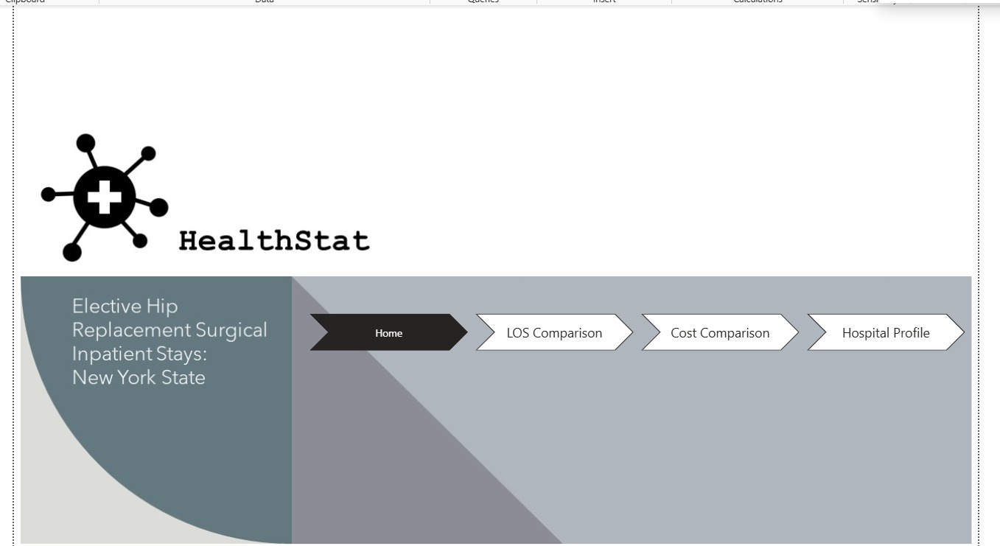
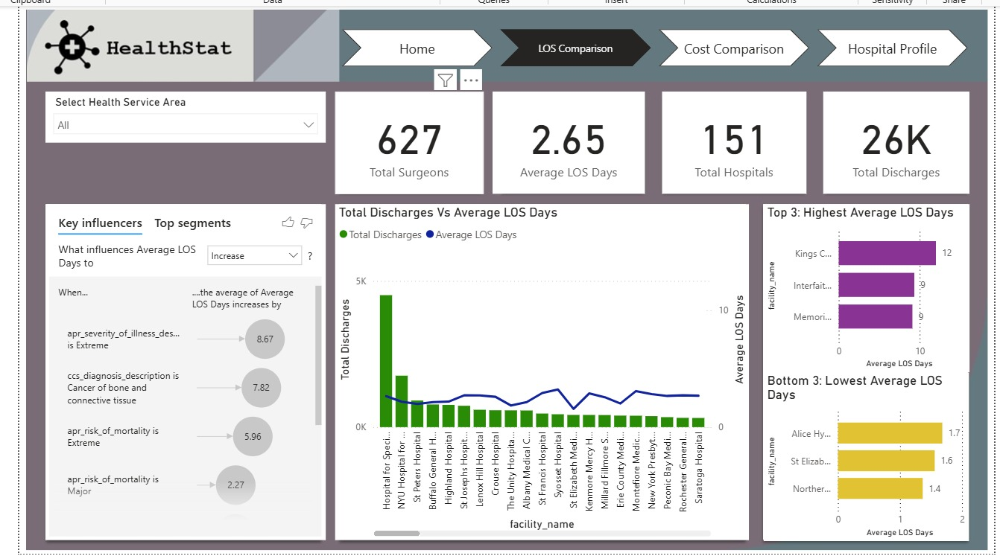
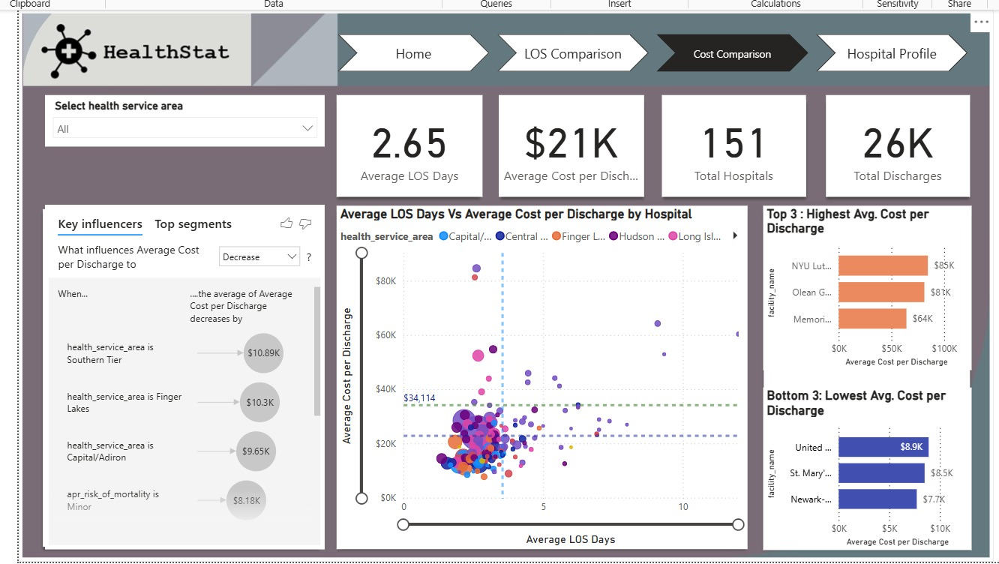
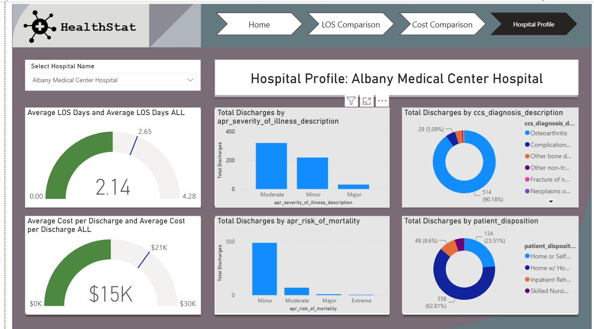

# HealthStat – Healthcare Operations & Performance Analytics

## Project Overview

HealthStat is an interactive Power BI dashboard developed to analyse hospital operational performance, length of stay (LOS), discharge volumes and healthcare costs across hospitals in New York State.

## Business Problem

Healthcare operations teams need to compare hospital performance and investigate variations in patient length of stay, discharge activity and treatment costs. This dashboard consolidates operational indicators and hospital-level comparisons to support performance monitoring and identify areas requiring further investigation.

## Key Analytical Findings

- 627 surgeons represented in the dashboard.
- 151 hospitals included in the analysis.
- Approximately 26K total discharges.
- Overall average Length of Stay: 2.65 days.
- Displayed average cost per discharge: approximately $21K.

## Dashboard Pages

1. Home – Project navigation.
2. LOS Comparison – Hospital-level length of stay and discharge comparisons.
3. Cost Comparison – Hospital cost benchmarking and LOS relationship.
4. Hospital Profile – Facility-level operational and patient profile analysis.

## Tools & Technologies

- Microsoft Power BI
- DAX
- Data Modelling
- Data Visualization
- Interactive KPI Reporting

## Business Value

The dashboard helps users compare hospital performance, investigate operational differences and identify facilities or patient segments that may warrant further review.

## Project Files

- Power BI dashboard: `dashboard/HealthStat.pbix`
- Dashboard screenshots: `screenshots/`
- Documentation: `documentation/`
## Dashboard Preview

### 1. Home – Project Overview

### 2. Length of Stay (LOS) Comparison

### 3. Hospital Cost Comparison

### 4. Hospital Profile

